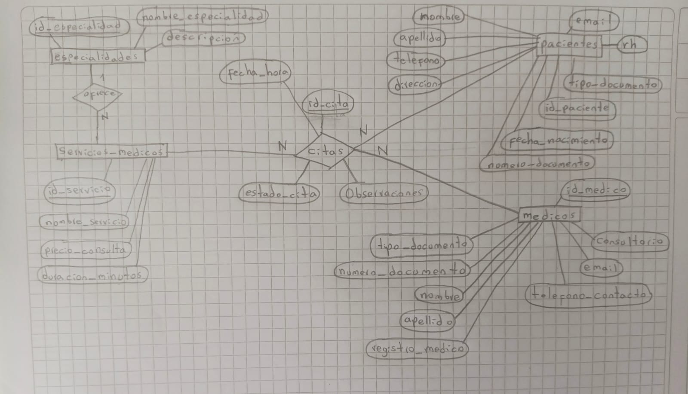

# Sistema de Gestión de Consultorio Médico (Citas Médicas)

Aplicación web CRUD desarrollada con **Python, Flask, PostgreSQL, HTML5 y Bootstrap 5**, orientada a la administración de un consultorio médico. El sistema permite gestionar especialidades, servicios médicos, pacientes, médicos y citas médicas, facilitando la organización y el control de la información.

---

## 1. Integrantes del Proyecto

- **Juan Sebastián Escobar Bernate**
- **Juan Esteban Parra Castañeda**

## 2. Descripción del Proyecto

El proyecto consiste en desarrollar una aplicación web para gestionar los procesos administrativos de un consultorio médico, permitiendo centralizar la información y facilitar la administración de las citas médicas.

El sistema cuenta con cinco tablas relacionadas entre sí, diseñadas bajo el modelo de normalización hasta la Tercera Forma Normal (3FN):

1. **Especialidades:** almacena las diferentes especialidades médicas disponibles en el consultorio.
2. **Servicios médicos:** registra los servicios y procedimientos médicos ofrecidos, relacionados con sus respectivas especialidades.
3. **Pacientes:** almacena la información personal y de contacto de los pacientes.
4. **Médicos:** registra la información de los profesionales médicos, sus especialidades y datos profesionales.
5. **Citas:** permite registrar y administrar las citas médicas, relacionando pacientes, médicos y servicios médicos, además de almacenar la fecha, hora y estado de cada cita.

## 3. Modelo Entidad-Relación (MER)

El proyecto cuenta con un Modelo Entidad-Relación (MER) que representa las cinco tablas, sus atributos, llaves primarias (PK), llaves foráneas (FK) y las relaciones entre ellas.

El modelo está diseñado siguiendo los principios de normalización hasta la Tercera Forma Normal (3FN).

**Diagrama del Modelo Entidad-Relación:**



## 4. Tecnologías Utilizadas

- **Python 3:** lenguaje de programación utilizado para desarrollar la aplicación.
- **Flask:** framework utilizado para construir la aplicación web.
- **PostgreSQL:** sistema de gestión de bases de datos relacional.
- **HTML5:** estructura de las páginas web.
- **Bootstrap 5:** diseño y estilos de la interfaz.
- **Jinja2:** motor de plantillas para Flask.
- **Git y GitHub:** herramientas para el control de versiones y almacenamiento del proyecto.

## 5. Requisitos Previos

Para instalar y ejecutar el proyecto es necesario contar con:

- Python 3.10 o superior.
- PostgreSQL 14 o superior.
- Git.
- pgAdmin 4 (opcional, para administrar la base de datos).

## 6. Instalación y Ejecución del Proyecto

### 6.1. Clonar el repositorio

Abrir una terminal y ejecutar:

```bash
git clone https://github.com/konax810/Citas-medicas.git
```

Ingresar a la carpeta del proyecto:

```bash
cd Citas-medicas
```

### 6.2. Crear el entorno virtual

En Windows

```bash
py -m venv .venv
Set-ExecutionPolicy -Scope Process -ExecutionPolicy RemoteSigned
.venv\Scripts\activate       
```

En Linux o macOS:

```bash
python3 -m venv .venv
source .venv/bin/activate
```

### 6.3. Instalar las dependencias

Ejecutar el siguiente comando:

```bash
pip install -r requirements.txt
```

### 6.4. Configurar las variables de entorno

Crear un archivo llamado `.env` a partir del archivo `.env.example`.

Configurar las credenciales de conexión a PostgreSQL:

```ini
DB_HOST=localhost
DB_PORT=5432
DB_NAME=consultorio_medico_db
DB_USER=tu_usuario_postgres
DB_PASSWORD=tu_contraseña
```

Reemplazar los valores de ejemplo por las credenciales correspondientes a la instalación local de PostgreSQL.

### 6.5. Configurar la base de datos

1. Abrir PostgreSQL mediante pgAdmin 4.
2. Crear una base de datos con el nombre `consultorio_medico_db`.
3. Seleccionar la base de datos creada.
4. Importar o ejecutar el archivo `database/consultorio_medico_db.sql`.
5. Verificar que las cinco tablas se hayan creado correctamente y que contengan sus respectivos registros.

### 6.6. Ejecutar la aplicación

Con el entorno virtual activado y la base de datos configurada, ejecutar:

en Windows
```bash
py app.py
```

en Linux o Mac
```bash
python3 app.py
```
Abrir el navegador e ingresar a:

```text
http://127.0.0.1:5000/
```

## 7. Capturas de Pantalla de la Aplicación

En esta sección se presentan evidencias visuales de la interfaz y las funcionalidades del sistema.

**Página principal:**


**Gestión de pacientes:**


**Gestión de médicos:**


**Gestión de citas médicas:**


---

## 8. Repositorio del Proyecto

El código fuente y los archivos correspondientes al desarrollo del sistema se encuentran disponibles en GitHub:

[Repositorio GitHub - Citas Médicas](https://github.com/konax810/Citas-medicas)

---

**Proyecto Final – Programación Web**

**Tema:** Sistema de Gestión de Consultorio Médico (Citas Médicas).