# Plan de pruebas funcionales

## Alcance y resultado de ejecución

Plan de 15 casos, tres por tabla, acorde con la rúbrica. La salida de `pytest --collect-only` confirmó **15 casos recopilados**. La última ejecución completa documentada, anterior a la corrección de PF-13, se hizo con `TEST_DB_NAME=consultorio_medico_test_db`, distinta de la base de desarrollo `consultorio_medico_db`: **15 aprobadas, 0 fallidas** (`15 passed in 19.56s`). PF-13 fue actualizado para cubrir la regla de estados por fecha y está pendiente de reejecución con una base de pruebas.

Los resultados de esta columna corresponden a aserciones reales de pytest; se indica la prueba automatizada que los demuestra. Las capturas de pantalla solicitadas aún están pendientes: no se registran como evidencia existente ni se presentan como si se hubieran tomado. Cuando se obtengan, deben guardarse en `docs/evidencias/` con los nombres indicados.

## Especialidades

| Caso | Tabla | Operación / escenario | Datos de entrada | Resultado esperado | Resultado obtenido / verificación automatizada | Evidencia |
|---|---|---|---|---|---|---|
| PF-01 — Ciclo CRUD de especialidad | `especialidades` | Crear una especialidad, comprobarla en el listado, editarla y eliminarla. | Nombre `ZZ_TEST_<token> ESPECIALIDAD`; descripción inicial de prueba; nombre editado con sufijo `EDITADA` y descripción vacía. | La creación, actualización y eliminación muestran sus mensajes de éxito; el listado contiene el registro creado; los valores editados quedan persistidos y la fila desaparece al eliminarla. | `test_PF_01_especialidades_ciclo_crud_listado_y_rutas` verificó creación, listado, formulario de edición, 404 para ID inexistente, actualización persistida y eliminación. También comprobó la carga de inicio, los listados y formularios de alta. | 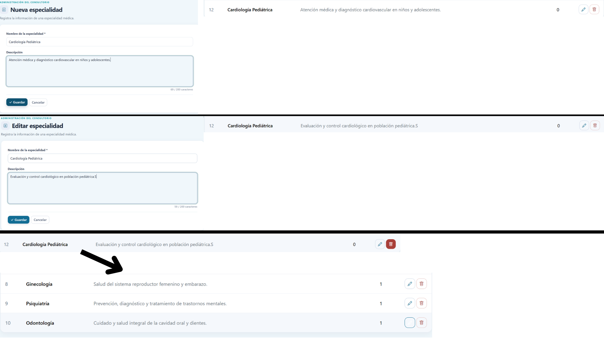. |
| PF-02 — Nombre requerido y duplicado | `especialidades` | Intentar crear un nombre ya registrado y enviar vacío el nombre requerido. | Nombre único generado para pytest; duplicado del mismo nombre; después, espacios en blanco. | La aplicación rechaza el duplicado y comunica que el campo es obligatorio cuando está vacío. | `test_PF_02_especialidades_nombre_requerido_y_unico` verificó ambos mensajes y las páginas principales. | 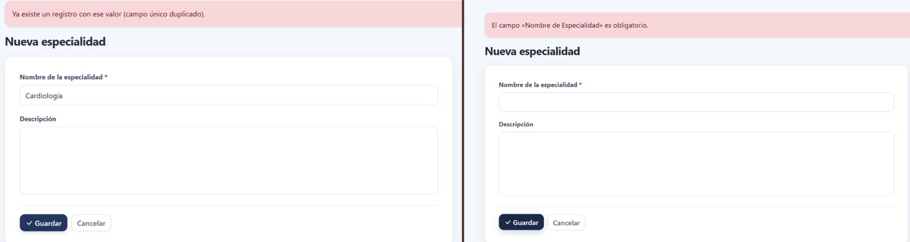. |
| PF-03 — Eliminar especialidad usada | `especialidades` | Intentar eliminar una especialidad referenciada por un servicio médico. | Especialidad de prueba con servicio dependiente y cita asociada. | La clave foránea impide la eliminación, la especialidad permanece y se informa que tiene registros relacionados. | `test_PF_03_especialidad_referenciada_no_se_elimina` comprobó el mensaje y que la especialidad sigue en la base de pruebas. | 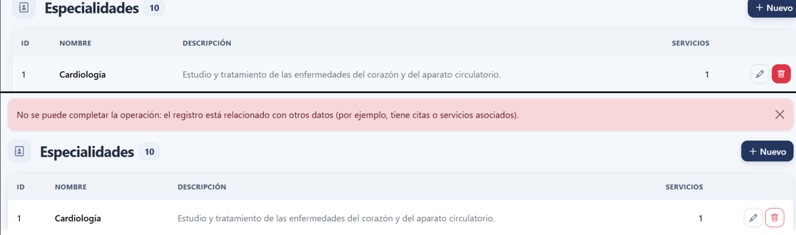. |

## Servicios médicos

| Caso | Tabla | Operación / escenario | Datos de entrada | Resultado esperado | Resultado obtenido / verificación automatizada | Evidencia |
|---|---|---|---|---|---|---|
| PF-04 — Ciclo CRUD de servicio | `servicios_medicos` | Crear un servicio, comprobarlo en el listado, actualizar precio y duración, y eliminarlo. | Servicio `ZZ_TEST_<token> SERVICIO`, especialidad válida, precio `12345.50`, duración `30`; edición a `999.50` y `45` minutos. | El servicio aparece en el listado, los cambios quedan persistidos y la eliminación lo retira del listado. | `test_PF_04_servicios_ciclo_crud_listado_y_rutas` verificó creación, listado, formulario de edición, 404 para ID inexistente, valores actualizados persistidos y eliminación. | 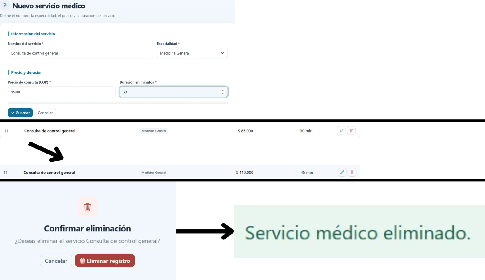. |
| PF-05 — Precio, duración y especialidad inválidos | `servicios_medicos` | Envío de valores numéricos inválidos y, en una solicitud separada con los demás datos válidos, referencia a especialidad inexistente. | Precio `-5`, duración `0`; precio `abc`; precio no numérico con especialidad vacía; luego precio y duración válidos con un ID de especialidad inexistente. | Se muestran validaciones de rango/formato y la referencia inexistente se rechaza por integridad referencial. | `test_PF_05_servicios_precio_duracion_formato_y_especialidad_invalidos` verificó por separado precio/duración fuera de rango, formato numérico, especialidad obligatoria y especialidad inexistente. | 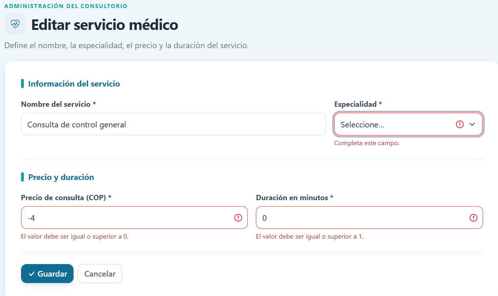. |
| PF-06 — Eliminar servicio usado por una cita | `servicios_medicos` | Intentar eliminar un servicio asignado a una cita existente. | Servicio y cita de prueba con paciente, médico y especialidad válidos. | La FK impide eliminar el servicio; permanece en la base y aparece un mensaje comprensible de registro relacionado. | `test_PF_06_servicio_referenciado_por_cita_no_se_elimina` verificó el mensaje y la permanencia del servicio. | 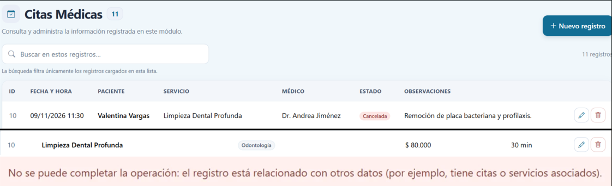. |

## Pacientes

| Caso | Tabla | Operación / escenario | Datos de entrada | Resultado esperado | Resultado obtenido / verificación automatizada | Evidencia |
|---|---|---|---|---|---|---|
| PF-07 — Ciclo CRUD de paciente | `pacientes` | Crear un paciente, comprobarlo en el listado, editar apellido y correo y eliminarlo. | Documento y correo únicos generados para la ejecución, datos personales válidos; edición del apellido y correo vacío. | El paciente aparece en el listado, los cambios quedan persistidos y la fila se elimina correctamente. | `test_PF_07_pacientes_ciclo_crud_listado_y_rutas` verificó creación, listado, formulario de edición, 404 para ID inexistente, valores actualizados persistidos y eliminación. | 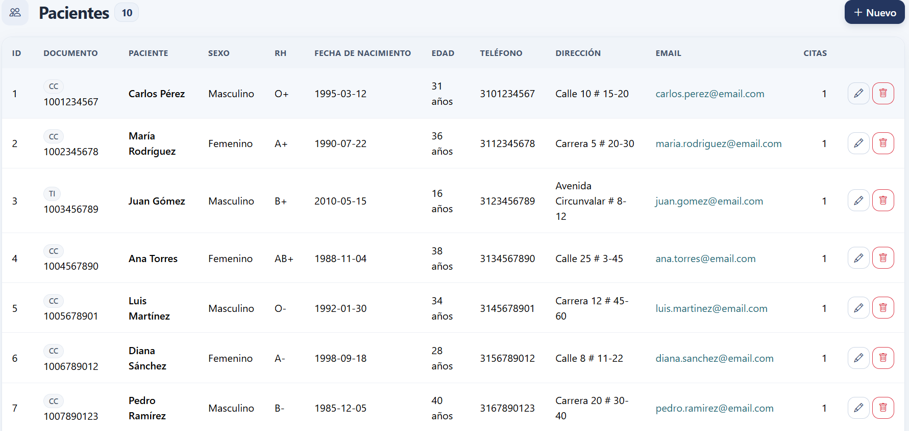. |
| PF-08 — Datos personales y correo inválidos | `pacientes` | Enviar valores que no pertenecen a las opciones permitidas y formatos inválidos. | Tipo de documento `XYZ`, sexo `Otro`, RH `ZZ`, fecha `no-es-fecha` y correo `correo-invalido`. | El formulario rechaza cada valor y comunica las validaciones correspondientes. | `test_PF_08_pacientes_formatos_valores_permitidos_y_documento_unico` comprobó el duplicado y los cinco mensajes de validación. | 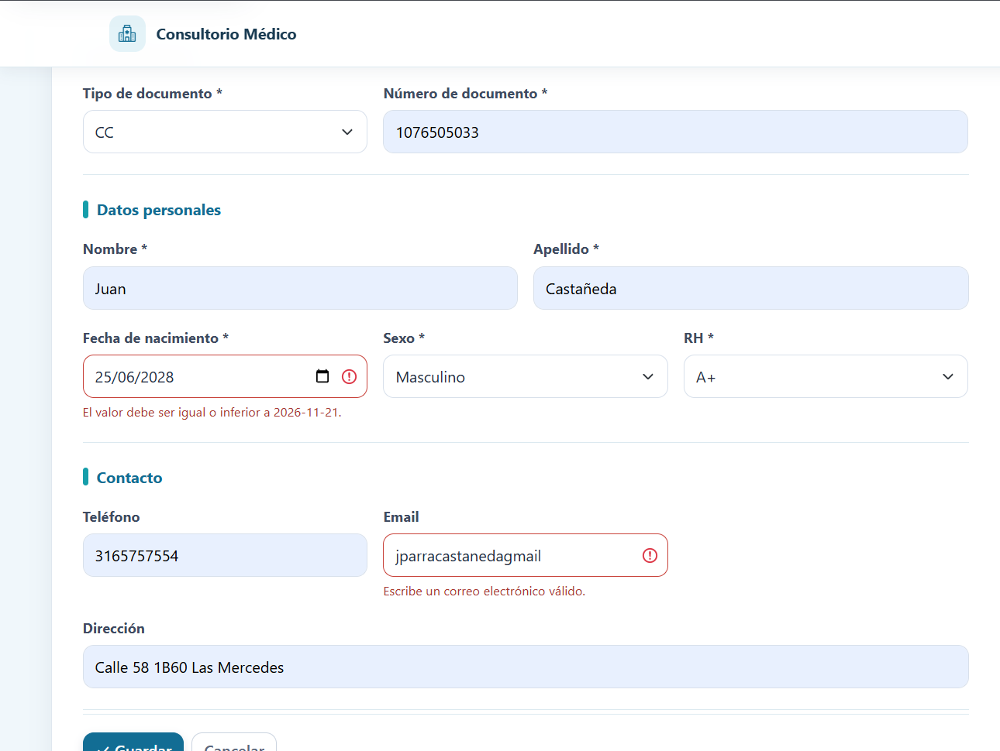. |
| PF-09 — Eliminar paciente con cita | `pacientes` | Intentar eliminar un paciente referenciado por una cita. | Paciente y cita de prueba vinculados. | La FK impide la eliminación; el paciente permanece y se informa que está relacionado. | `test_PF_09_paciente_referenciado_por_cita_no_se_elimina` verificó el mensaje y la permanencia del paciente. | 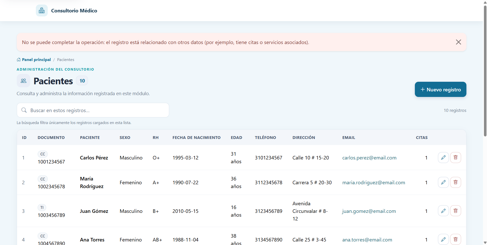. |

## Médicos

| Caso | Tabla | Operación / escenario | Datos de entrada | Resultado esperado | Resultado obtenido / verificación automatizada | Evidencia |
|---|---|---|---|---|---|---|
| PF-10 — Ciclo CRUD de médico | `medicos` | Crear un médico, comprobarlo en el listado, cambiar consultorio y eliminarlo. | Documento, registro profesional y correo únicos; consultorio inicial `TEST-1`, actualizado a `TEST-2`. | El listado muestra el médico, el cambio queda persistido y se elimina correctamente. | `test_PF_10_medicos_ciclo_crud_listado_y_rutas` verificó creación, listado, formulario de edición, 404 para ID inexistente, actualización persistida y eliminación. | 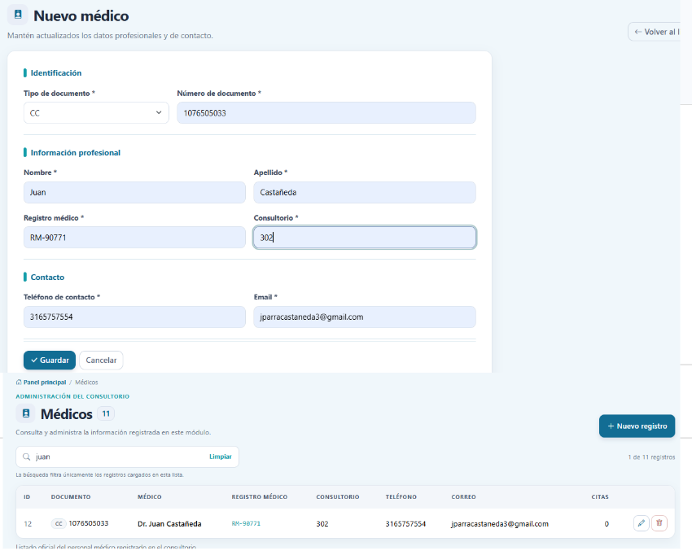. |
| PF-11 — Tipo de documento, correo y datos únicos | `medicos` | Rechazar tipo de documento y correo inválidos, y valores duplicados en documento, registro profesional o correo. | Tipo `XYZ`, correo `correo-malo`; duplicados de cada uno de los tres campos únicos. | El formulario muestra errores de formato y evita insertar valores únicos repetidos. | `test_PF_11_medicos_formatos_y_campos_unicos` verificó formato inválido y los duplicados de documento, registro profesional y correo en un único caso pytest. | 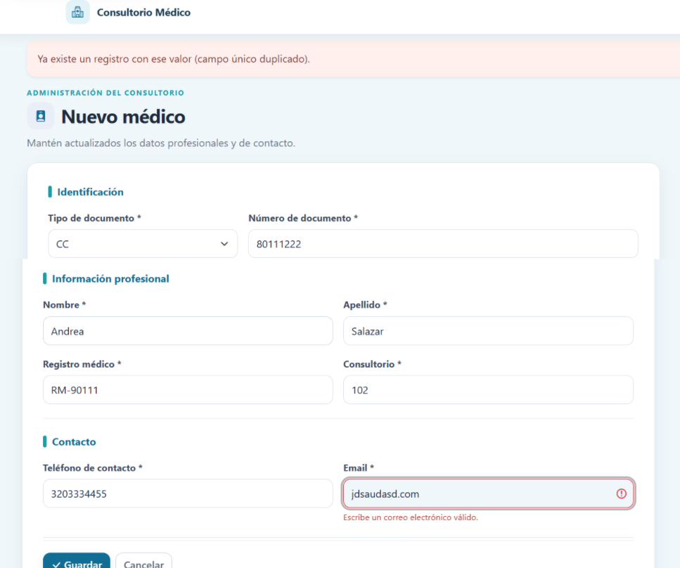. |
| PF-12 — Eliminar médico con cita | `medicos` | Intentar eliminar un médico que atiende una cita existente. | Médico y cita de prueba relacionados. | La FK impide la eliminación; el médico permanece y se informa que está relacionado. | `test_PF_12_medico_referenciado_por_cita_no_se_elimina` verificó el mensaje y la permanencia del médico. | 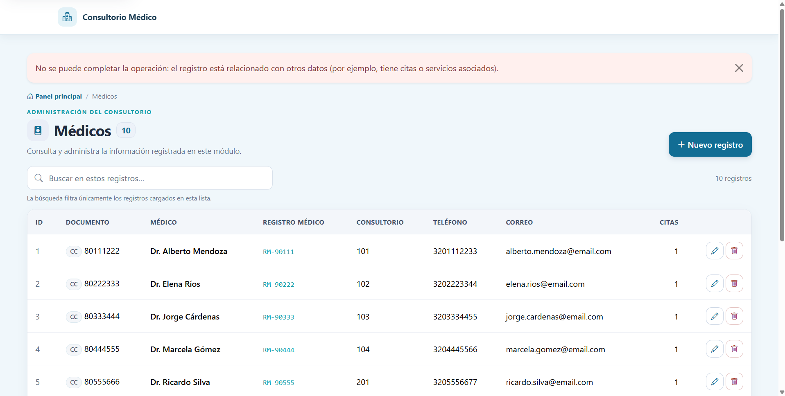. |

## Citas

| Caso | Tabla | Operación / escenario | Datos de entrada | Resultado esperado | Resultado obtenido / verificación automatizada | Evidencia |
|---|---|---|---|---|---|---|
| PF-13 — Ciclo CRUD de cita | `citas` | Intentar crear una cita futura como atendida, crearla como programada, comprobarla en el listado, cancelarla y luego intentar marcarla como atendida; finalmente moverla al pasado, marcarla como atendida y eliminarla. | Fecha futura `2099-01-01T10:00`, paciente/servicio/médico existentes y estado inicial `Programada`. | Se rechaza crear o editar una cita futura como `Atendida`, incluidas las citas de hoy cuya hora aún no llega; el registro no se inserta ni se modifica. Se permite guardar la cita futura como `Programada` o `Cancelada`. Una fecha pasada sí permite cambiar el estado a `Atendida`. | `test_PF_13_citas_ciclo_crud_listado_y_rutas` cubre la validación de estado por fecha, la persistencia de los cambios permitidos y la eliminación; queda pendiente ejecutarla con una base de pruebas. | 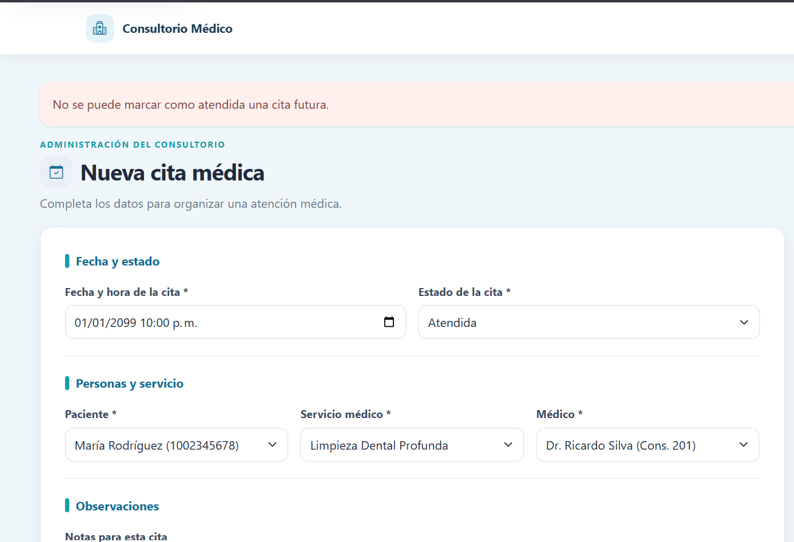. |
| PF-14 — Fecha, relaciones y estado inválidos | `citas` | Enviar fecha inválida, claves foráneas vacías y estado no permitido. | Fecha `fecha-invalida`, paciente/servicio/médico vacíos, estado `No existe`. | El formulario conserva los valores enviados y presenta las validaciones de fecha, campos requeridos y estado. | `test_PF_14_citas_fecha_campos_requeridos_y_estado_invalidos` pasó; comprobó errores, respuesta del formulario y conservación/renderizado del valor de fecha enviado como texto. | 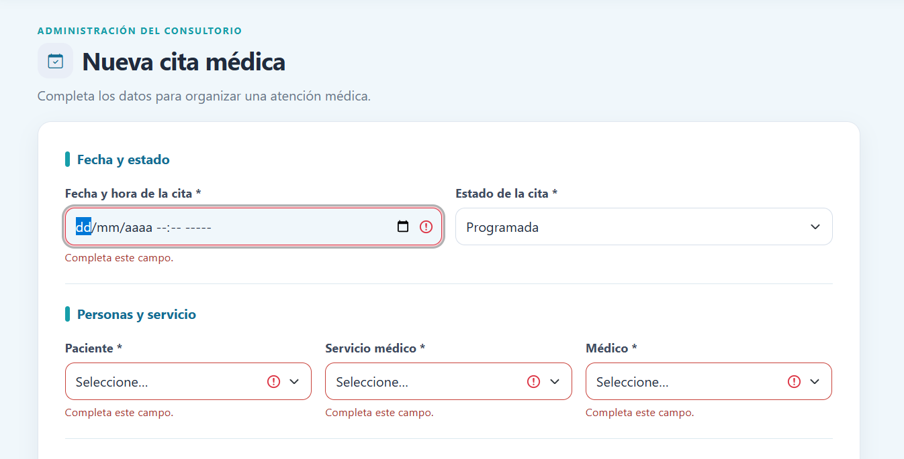. |
| PF-15 — Clave foránea inexistente y alcance de eliminación | `citas` | Intentar crear una cita con paciente inexistente. No aplica el escenario de eliminar una cita referenciada: ninguna tabla del esquema tiene una FK que apunte a `citas`. | Fecha, estado, servicio y médico válidos; ID de paciente inexistente. | La base rechaza la relación inexistente y la aplicación informa el error. La ausencia de registros hijos de citas se documenta como limitación del esquema, no como una relación que la app deba soportar. | `test_PF_15_citas_rechaza_clave_foranea_inexistente` comprobó el rechazo y el mensaje de relación inválida, y consultó el esquema para verificar que no hay tablas que referencien a `citas`. | . |
